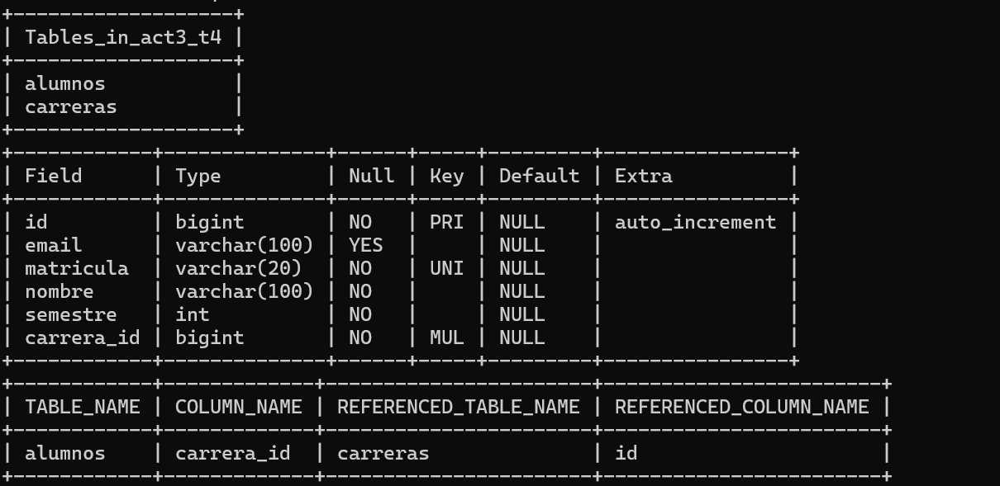
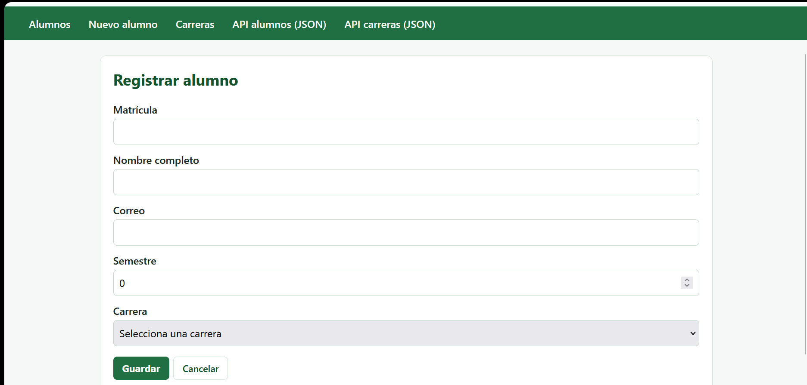
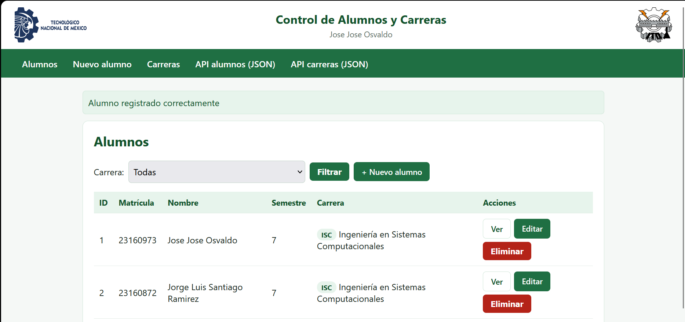
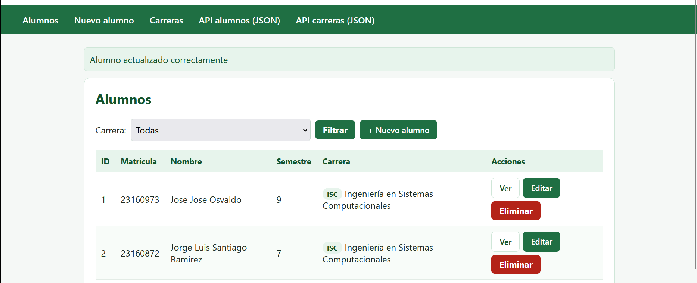
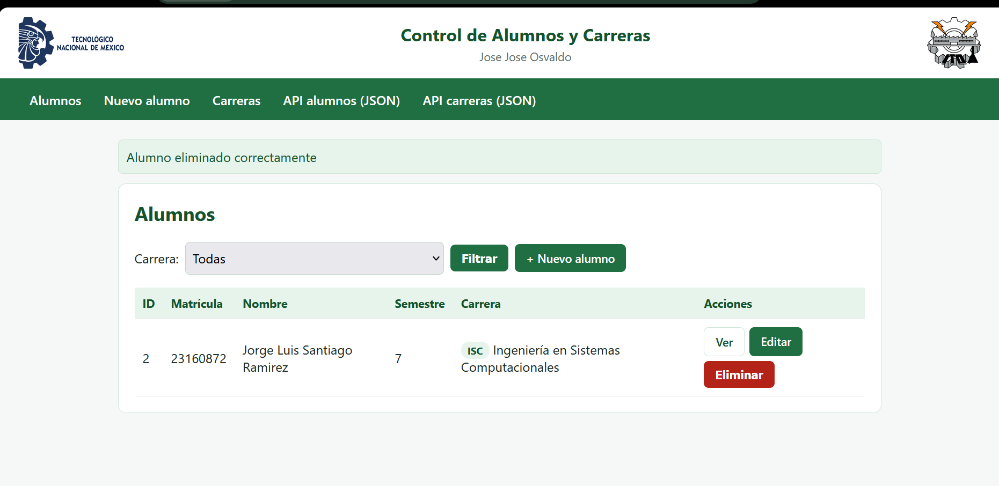
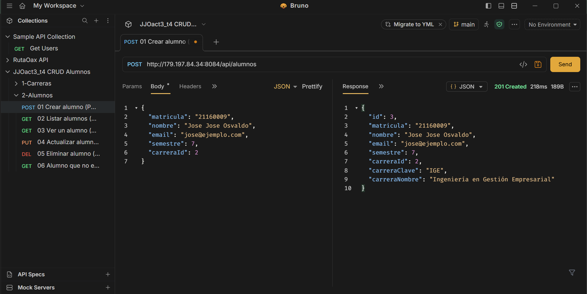

# JJOact3_t4 — CRUD en Spring Boot con JPA, MySQL y relaciones

CRUD completo de **Alumnos** relacionado con **Carreras** (muchos alumnos pertenecen a una carrera),
con vistas Thymeleaf y API REST dentro del mismo proyecto, persistiendo en MySQL.

**Alumno:** Jose Jose Osvaldo — Ingeniería en Sistemas Computacionales, 7.º semestre
**Institución:** TecNM Campus Oaxaca

## Tecnologías
- Java 21 · Spring Boot 4.1.2
- Spring Web MVC · Spring Data JPA · Thymeleaf
- MySQL (driver `mysql-connector-j`)
- VPS Ubuntu, puerto **8084** (Act1 en 8081 y Act2 en 8083 siguen corriendo)

## Entidades y relación

| Entidad | Tabla | Relación |
|---|---|---|
| `Carrera` (id, clave, nombre) | `carreras` | `@OneToMany(mappedBy = "carrera")` → una carrera tiene muchos alumnos |
| `Alumno` (id, matricula, nombre, email, semestre) | `alumnos` | `@ManyToOne` + `@JoinColumn(name = "carrera_id")` → llave foránea hacia `carreras.id` |

```
carreras (id PK, clave, nombre)
   1
   │
   N
alumnos (id PK, matricula, nombre, email, semestre, carrera_id FK → carreras.id)
```

## Estructura (separación de capas)

```
src/main/java/com/tecnm/act3/
├── entity/        Alumno, Carrera              (JPA)
├── repository/    AlumnoRepository, CarreraRepository   (extienden JpaRepository)
├── service/       AlumnoService, CarreraService         (lógica de negocio)
├── controller/    AlumnoViewController, CarreraViewController  (vistas Thymeleaf)
│                  AlumnoApiController, CarreraApiController    (REST / JSON)
│                  ApiExceptionHandler                          (errores 400/404/409)
├── dto/           AlumnoRequest, AlumnoResponse, CarreraResponse
└── config/        DatosIniciales (inserta carreras si la tabla está vacía)
```

## CRUD

### Vistas (navegador)
| Operación | Ruta |
|---|---|
| Leer (lista con nombre de carrera) | `GET /alumnos` |
| Leer (filtrar por carrera) | `GET /alumnos?carreraId=1` |
| Leer (detalle) | `GET /alumnos/{id}` |
| Crear | `GET/POST /alumnos/nuevo` |
| Actualizar | `GET/POST /alumnos/{id}/editar` |
| Eliminar | `POST /alumnos/{id}/eliminar` (con confirmación) |
| Carreras | `GET /carreras` (con número de alumnos por carrera) |

### API REST (Postman / Bruno)
| Método | Ruta | Respuesta |
|---|---|---|
| `POST` | `/api/alumnos` | 201 con el alumno y el **nombre de su carrera** |
| `GET` | `/api/alumnos` | 200 lista |
| `GET` | `/api/alumnos/{id}` | 200 / 404 |
| `PUT` | `/api/alumnos/{id}` | 200 actualizado |
| `DELETE` | `/api/alumnos/{id}` | 204 |
| `GET` | `/api/carreras` | carreras con total de alumnos |
| `GET` | `/api/carreras/{id}/alumnos` | alumnos de una carrera |
| `POST` | `/api/carreras` | 201 |

Ejemplo de body para crear o actualizar:
```json
{ "matricula": "21160001", "nombre": "Jose Jose Osvaldo", "email": "jose@ejemplo.com", "semestre": 7, "carreraId": 1 }
```
Respuesta (la relación se refleja con el nombre de la carrera):
```json
{ "id": 1, "matricula": "21160001", "nombre": "Jose Jose Osvaldo", "email": "jose@ejemplo.com", "semestre": 7,
  "carreraId": 1, "carreraClave": "ISC", "carreraNombre": "Ingeniería en Sistemas Computacionales" }
```

La colección de Bruno está en la carpeta [`bruno/`](bruno) (entornos `Local` y `VPS`).

## Capturas

### Entidades relacionadas (tablas y llave foránea en MySQL)


### Crear


### Leer (la carrera aparece por nombre)


### Actualizar


### Eliminar


### Prueba en Bruno/Postman


## Configuración de la base de datos

`application.properties` **no tiene contraseñas reales**: las lee de variables de entorno.

| Variable | Valor por defecto (solo para pruebas locales) |
|---|---|
| `DB_URL` | `jdbc:mysql://localhost:3306/act3_t4?createDatabaseIfNotExist=true&serverTimezone=America/Mexico_City` |
| `DB_USER` | `root` |
| `DB_PASS` | (vacío) |

Hibernate crea las tablas automáticamente (`spring.jpa.hibernate.ddl-auto=update`).

## Cómo correrlo
```
mvnw.cmd clean package -DskipTests
java -jar target/act3-0.0.1-SNAPSHOT.jar
```
Entra a `http://localhost:8084/alumnos`.

## Demo en línea
- http://179.197.84.34:8084/alumnos
- http://179.197.84.34:8084/api/alumnos
